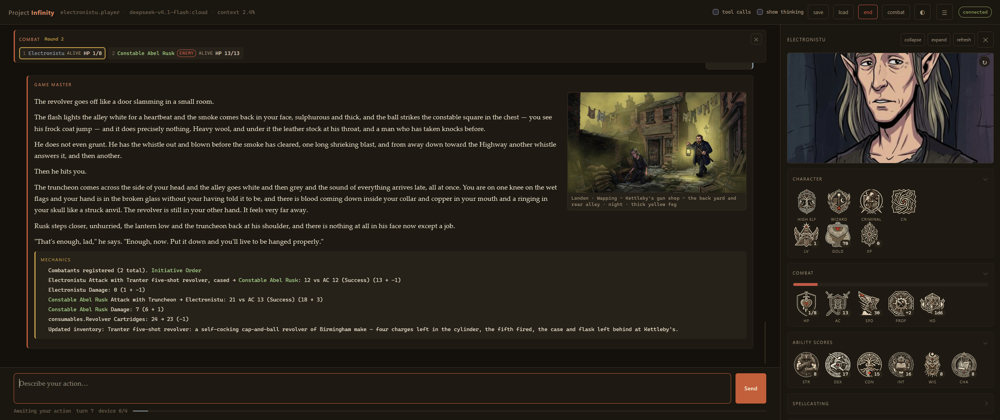

# Project Infinity

*Local web client · Ollama Cloud & Google Gemini models*



**Images are optional but recommended** — they carry your character's portrait, an illustration of each turn.

---

## Two games modes

You pick one when you create the character. Everything else — the rules engine, the sheet, the images, the saving — is the same game either way.

### Classic — the invented world

An invented realm of four kingdoms, a decade after a war that ended in an uneasy peace: old grievances, guarded borders, and a peace nobody trusts. A straightforward campaign, played straight — the Game Master builds the story on top of the political scaffold.

### Time Traveler — the Device

You are a Traveler from the future — from New York in 2400 — carrying a **hollow** timepiece missing the four parts that would make it whole. You command it from the first turn: choose the age it reaches, the place, and when to go — but the future you came from is closed to it until every part is found. The way home is to find what it lost.

Every age is peopled by **all the common races** — dwarf, elf, halfling, human, dragonborn, gnome, half-elf, half-orc, tiefling — and by all the common classes, living there as they always have; a crowd is mixed and nobody finds it strange. The history stays real. What **does** stand out is your **kit**: a pistol bought in 1888 is a pistol in 2560 BC, people notice.

**Your first age is rolled at random** when the character is created; after that, you choose where and when.

---

## Run it

**You need:** Python 3.11+, and [Ollama](https://ollama.ai/) installed and signed in (the default Game Master models are Ollama Cloud tags). A Google AI Studio API key is **recommended** — it unlocks all image generation (portrait, scenes, sheet icons) and the Gemini Game Master models. Without it the game runs text-only.

```bash
git clone <repo-url>
cd Project_Infinity
python3 -m venv venv
source venv/bin/activate      # Linux/macOS
# venv\Scripts\activate       # Windows
pip install -r requirements.txt
```

Copy `.env.example` to `.env` and set `GEMINI_API_KEY` — with it, images are on; without it, the game runs text-only.

```bash
venv\Scripts\python.exe web_server.py     # Windows
python3 web_server.py                     # Linux / macOS
```

Open **http://127.0.0.1:8000**. The server binds to localhost only. Flags: `--host`, `--port`, `--reload`, `--log-level`.

A browser that stays connected keeps its game alive indefinitely, however long you pause. After the last browser disconnects, the session is kept for `PI_SESSION_TTL_SECONDS` (default `3600`, `0` = never reap) so a dropped connection can reconnect; `PI_SESSION_SWEEP_SECONDS` (default `60`) sets how often that cleanup runs.

---

## Creating a character

**Create character** on the start screen opens the in-browser **Character Forge**: the full SRD 5.1 creation flow, asked one step at a time.

Your character is written to `output/yourcharacter.player`. **In Time Traveler, the Forge rolls your first age** — you have not aimed the Device yet, and the Game Master chooses where in it you land — and seeds your standing in that age's own powers.

---

## Playing

Type an action in plain English and the Game Master handles the rest. You do not roll anything and you do not need to know the rules.

**A turn looks like this.** Your action goes to the GM. The status line may briefly show *"synchronizing with the engine…"* while it resolves the mechanics, then *"GM is thinking…"*. The **narrative streams in** as second-person prose. At the end of the turn the **Mechanics panel** appears, written by the engine from the real results — who acted on whom, what was rolled, what changed. Status returns to *"Awaiting your action"*.

Nothing in that panel is generated by the model. If a blow lands, it landed; if a spell slot burned, it is gone.

**When a fight starts, a combat bar opens above the transcript** and stays for the rest of the battle — the whole fight at a glance. It lists every combatant in **initiative order** with their **HP**, **conditions**, whether they are an **ally or an enemy**, and whether they are **alive, dead, fled or surrendered**, and it highlights the **next in line**. Names are green: hover one in the bar (or anywhere in the narrative) for that combatant's **live sheet**. **✕** closes the bar and the header's **combat** button brings it back; it closes itself when the fight ends.

### Your character sheet

**☰ Character sheet** opens the live sidebar — stats and modifiers, saving throws, skills with their passive scores, your spellbook and slots, inventory with tooltips for every item's stats, equipped gear and how your armour class is derived, active conditions, exhaustion, your reputation with the powers of the age you are in, and — in Time Traveler — the **Device card** (its four parts and your controls). **Refresh** reloads it straight from the engine at any time; **↻** repaints your portrait from your current level and gear.

### Images (recommended)

Image generation needs the Google key (see **Run it**) and is **cached** — an image is drawn once and reused until the data behind it changes. Tick **images** on the start screen or in the Load dialog:

- **Character portrait** — on the start screen and your sheet.
- **Storyline scenes** — one cinematic 16:9 illustration per turn. Each place keeps a hidden establishing reference, so places and regulars stay consistent; **hover an illustration to see it full size**. Each carries a caption — area, place, time of day and weather.
- **Art style** — an optional free-text style applied to portraits and scenes (a cartoon, a period look); leave it empty for the default dark-fantasy sourcebook. Changing it repaints your portrait and redraws each place as you revisit it.
- **Sheet icons** — the shared, cross-character library used by the sheet.

Everything is cached and regenerates only when the data behind it changes.

### The Device (Time Traveler)

There is no countdown and no forced jump — the Device is yours to command.

- **You choose when it jumps.** Open the Device, pick an age — or the one you are already in, to move within it — then an area, a ward and a place, and release it. The one throw you do not choose is a brand-new character's first age.
- **You choose where it lands.** Any historical age, and a place: the age's own destinations, or one you have already visited. Once an area's places fall under more than one **ward**, the picker offers them ward by ward, so a whole city stays reachable. **New York, the far future** is the one age the Device cannot reach until every part is found.
- **A jump within the age is a move, not a new session.** The story, the STATE page, the place tree and reputation all continue, so people remember what you did — and those who see you vanish or appear react to it. Only a crossing into another age rewrites that age's memory and resets your spells.
- **The place you choose is the place you get.** An exact landing is handed to the Game Master as its whole path and held for the turn, so the arrival is narrated there rather than invented nearby.
- **When you cross into another age, the one you leave keeps two memories.** Its **legend** holds the story and the people the story turns on; a separate **roll** holds the name of everyone you met there. On a return, the Game Master is told both groups know you on sight — so the shopkeeper remembers the stranger who vanished, and the regulars are not strangers again. Nothing else survives the crossing: the dialogue is gone, the memory is not a transcript.
- **Nothing is left behind.** You keep everything you are carrying through every jump, and it stays literal: a Victorian pistol is a Victorian pistol in the Old Kingdom, and people will notice.
- **The Device answers to you from the first turn** — a broken thing of the far future in your inventory. Its **four missing parts** — the Escapement, the Compass Rose, the Regulator and the Mainspring — lie scattered, one to an age; recover them all and the Device can reach **New York, the far future**, the one age closed to it until then. When you recover one, the Game Master adds it to your pack, and it records **which age you found it in**.

### Companions

A companion is a full character who travels with you — **your companions come with you when the Device jumps** (the Game Master decides how each takes it), so the party is **one party, at most three in total, in every age**. In the classic game there is one world, so it is three in total and it crosses the kingdoms with you. The Game Master declares the sheet once — **ability scores, AC, hit points, attacks, any combat advantages and immunities, and a stable look** — and from then on simply names the companion when a fight starts: the engine fills in the stat block and hands it back, so the numbers never drift and never cost prompt space between fights. Because the sheet carries its ability scores, the engine also rolls **its own skill checks and saves**, instead of trusting a number the Game Master worked out. **No current hit points are stored** — each fight starts in full unless the Game Master says otherwise, so a rest never has to heal anyone and a companion is never left bleeding from a fight three sessions ago. Its **name**, identity and look are in the injected **CHARACTER SHEET** (re-injected after every age crossing); what it is *doing* in the world — the trade it runs in your name, who it answers to — is a hook, a debt or canon on your state page.

### Saving and loading

**There is no autosave — progress persists only when you save.** Saving is **in place**: a save writes its own files and never renames them, because its images live under a folder keyed to its name. A save rewrites your character, appends a session **timeline** — the Game Master's concise account of the turns since the last save — and rewrites a short **state notebook** (your current goal, the live hooks, what advances, what you owe, what only you know, what must stay true and what is still unpaid). The timeline also keeps each age's **legend** (that age's memory of your story, naming the people it turns on) and its **met roll** (names only, everyone you met there), so a return is recognized. In the time-travel game that notebook is **scoped to the age**: one page per age, of which only the age you are standing in reaches the Game Master — so returning to Wallachia hands it Wallachia's truth, not Egypt's. Every age is dated to **one exact year**, and the Game Master is told it, so the notebook never invents a date. Loading injects both, so a long campaign stays coherent. Because that memory must not grow without limit, the older entries are periodically **compacted into one chronicle** — the recent events stay verbatim, everything older becomes a single short "story so far". **Saving is refused while a fight is live** — you'll be told *"Combat is not over. If you think it is, inform the Game Master."* and can end it by telling the GM. Saves are listed on the start screen and in the **Load** picker.

The Game Master reads your character from a **lean sheet the engine injects** — identity, hit points, gold, speed and encumbrance, conditions, features, your pack by name, what you wear and hold, your consumables, the reputation shape of the age you stand in, and your companions; the engine re-injects it after every age crossing, so it can never be skipped. Combat math (ability scores, saves, skills, AC, hit dice) and your spell list are deliberately absent: the engine derives them. A caster can only cast a spell the character actually has — a cantrip they know, a prepared or known spell, a domain/oath/circle spell (always prepared), or a spellbook spell as a ritual; a scroll carries its own. Attempting anything else casts nothing and costs no action: the engine hands the Game Master the character's real options instead.

### When the Game Master forgets something

The GM is an AI and can miss an update. If you spot one, **tell it directly** — exactly as you would a human DM. The engine is authoritative, so a direct instruction is all it takes to correct your state, or the GM will re-derive it on the next rule call.

This works for any missed mechanic: gold, inventory, spell slots, hit dice, conditions, or an item whose state changed (a note opened, a lamp lit).

### How it works under the hood

Everything technical — the engine that resolves the rules, what the Game Master is allowed to see, how images stay consistent, how state is stored, and how to run the test gate — is in **[HowItWorks.md](HowItWorks.md)**.

---

## Licensing & Legal

This project has a **dual-license structure** to comply with copyright law and Wizards of the Coast's intellectual property rights.

### Source Code — MIT License

All **original source code** in this project (the game engine, web client, MCP server, dice server, world forge, and all `.py` source files) is licensed under the [MIT License](LICENSE). See `LICENSE` for the full terms.

### D&D 5e Rules Content — CC-BY-4.0 (via SRD 5.1)

All **embedded D&D 5e rules data** — including spell descriptions, class features, racial traits, background features, weapon statistics, and game mechanics found in `config/` files — is derived from the **System Reference Document 5.1 (SRD 5.1)**, published by Wizards of the Coast LLC under the **Creative Commons Attribution 4.0 International License (CC-BY-4.0)**.

This content is **NOT covered by the MIT license**. It is used under a separate open license that permits public use with proper attribution. See `SRD_LICENSE.txt` for the full attribution text and additional details.

### Required SRD Attribution

> "This work includes material taken from the System Reference Document 5.1 ("SRD 5.1") by Wizards of the Coast LLC, available at https://dnd.wizards.com/resources/systems-reference-document. The SRD 5.1 is licensed under the Creative Commons Attribution 4.0 International License available at https://creativecommons.org/licenses/by/4.0/legalcode."

### What Is NOT Included

To maintain legal compliance, this project has been audited to exclude all **non-SRD content** from its distributed files. Specifically:

- **Product Identity** (Beholders, Mind Flayers, Displacer Beasts, Carrion Crawlers, Githyanki, Githzerai, Kuo-Toa, Slaadi, etc.)
- **Named Characters** (Strahd, Bigby, Mordenkainen, Tasha, Drizzt, etc.)
- **Non-SRD Spells** (Booming Blade, Green-Flame Blade, Absorb Elements, Toll the Dead, Chaos Bolt, etc.)
- **Non-SRD Races/Subraces** (Drow, Stout Halfling, etc.)
- **Non-SRD Classes** (Artificer)
- **Proprietary Setting Lore** (Forgotten Realms geography, unique deities, faction names)

### AI-Generated Content at Runtime

The AI Game Master operates on general-purpose models that may have been trained on the broader D&D corpus. Despite prompt-level restrictions instructing the GM to adhere strictly to SRD content, **the project cannot guarantee that AI-generated narrative will never reference non-SRD material at runtime**. This is a known limitation of AI-powered applications and is explicitly disclosed.

### Not Affiliated with Wizards of the Coast

This project is **not affiliated with, endorsed by, sponsored by, or connected to Wizards of the Coast LLC** in any way. Dungeons & Dragons and D&D are trademarks of Wizards of the Coast LLC in the USA and other countries.

---

## License

- **Original source code**: [MIT License](LICENSE)
- **D&D 5e rules data (config files)**: [Creative Commons Attribution 4.0 International](SRD_LICENSE.txt), via the [D&D SRD 5.1](https://dnd.wizards.com/resources/systems-reference-document)
